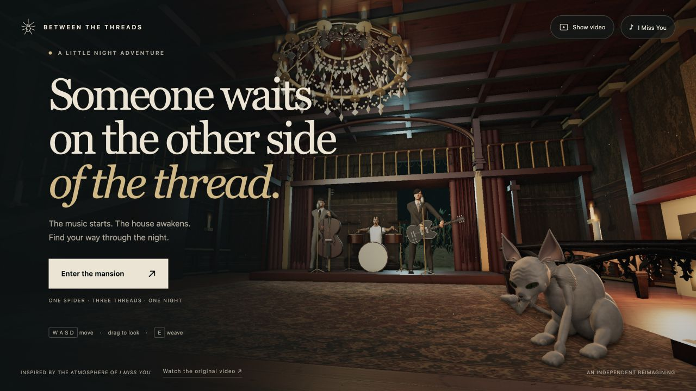

# I Miss You — A blink-182 Game

Explore a candlelit mansion **as a spider**, inspired by the atmosphere of blink-182’s *I Miss You* music video. Find three silk threads, cross the gallery and garden, and reach the spider waiting at the window.

**[Play the game](https://blink-182-i-miss-you-spider-game.vercel.app/)** · **[Contribute](CONTRIBUTING.md)** · **[Roadmap](docs/ROADMAP.md)** · **[Asset credits](THIRD_PARTY_NOTICES.md)**



The playable adventure is called *Between the Threads*. This repository uses the more explicit `blink-182-i-miss-you-spider-game` name so fans can find it. It is an independent fan project, not an official blink-182 game.

## Help make it better

Artists, animators, game designers and developers are welcome. The biggest opportunities are more natural characters and animation, richer lighting and materials, better spider movement, clearer exploration and mobile performance. Fork the repository and open a pull request. For a large change, open an issue first so we can discuss the approach.

Editable Blender scenes, source textures, model-building scripts and the complete browser game are included. No account, API key, game engine subscription or backend is needed to run it.

## Play locally

Requirements: **Python 3** for the local server. **Node.js 22+** is needed for the checks and npm shortcuts.

```sh
git clone https://github.com/jpzank/blink-182-i-miss-you-spider-game.git
cd blink-182-i-miss-you-spider-game
python3 -m http.server 4173 -d dist
```

Open **http://localhost:4173**. `npm start` runs the same server. On Windows, use `py -3 -m http.server 4173 -d dist` if `python3` is unavailable.

Three.js is already vendored, so installation is unnecessary for playing or running tests. Serve the directory over HTTP instead of opening `index.html` as a file. The official YouTube player requires internet access; the game can still run when the video is unavailable.

```sh
npm test
npm run check
```

`npm ci` is only needed when working with the npm copy of Three.js. The browser imports the files in `dist/vendor/`; changing the npm dependency alone does not replace those files.

## Controls

| Control | Action |
| --- | --- |
| WASD / arrow keys | Move |
| Drag the scene | Look around |
| E | Weave a thread, cross, or finish the reunion |
| Q | Face the next objective |
| Space | Small jump |
| Esc | Pause / resume |
| Left joystick on mobile | Move |
| Drag on the right on mobile | Look around |

The × in the video panel closes it while music continues. **Show video** reopens the same player. **Pause music** controls the soundtrack separately. The pause menu includes a steady-camera option.

The reclining scene is on the right of the entrance, beneath the window. Climb the hanging cover to explore the bed. The Sphynx cat sends you back to your last checkpoint if you get too close.

## Project map

| Path | Purpose |
| --- | --- |
| `dist/game.js` | Camera, movement, input, collisions, UI and game loop |
| `dist/rules.js` | Objectives, progression and completion rules |
| `dist/world.js` | Mansion, garden, lights and environment |
| `dist/spider.js` | Spider geometry and leg motion |
| `dist/musicians.js` | Band loading and performance animation |
| `dist/alcove.js` | Bed, reclining figures, Sphynx and walkable textiles |
| `dist/music.js` | Official YouTube player and soundtrack clock |
| `dist/style.css`, `dist/index.html` | English interface and responsive layout |
| `dist/models/`, `dist/textures/` | Ready-to-use runtime assets |
| `assets-src/`, `scripts/` | Editable art sources and Blender builders |
| `tests/` | Progression, music and asset checks |

This is a buildless static game. Vercel serves `dist/` and deploys the `main` branch. Pull requests can get preview deployments; changes from forks require owner authorization in Vercel. GitHub validation CI runs checks separately. See [deployment instructions](docs/DEPLOYMENT.md).

## Editing the art

See **[the asset workflow](docs/ASSET_WORKFLOW.md)** for Blender files, export conventions and model checks. Builders were developed with Blender 5.1.2 and use the sources included here.

```sh
blender -b --python scripts/build-musicians.py
blender -b --python scripts/build-reclining-women.py
blender -b --python scripts/build-sphynx.py
```

These commands overwrite the corresponding generated GLBs and some baked source maps. Commit your work first. You do not need Blender to play or change gameplay.

## Current limits

The mansion is an artistic interpretation of the video set. Faces, anatomy and performances are approximations; animations are short authored loops, not motion capture or exact lip-sync. Close-up fabric, hair and contact poses still need work. Desktop viewport tests do not replace testing on a physical phone. These are good places to contribute.

## License and credits

Original project code and original project-authored materials are offered under the **[MIT license](LICENSE)**, subject to the component notices in **[THIRD_PARTY_NOTICES.md](THIRD_PARTY_NOTICES.md)**. Three.js retains its MIT notice. MakeHuman core assets and Poly Haven assets retain their CC0 status.

The *I Miss You* recording and music video are **not included or licensed by this repository**; playback uses the official YouTube embed. The project license does not grant rights to the band’s name, trademarks or likenesses. This project is not affiliated with or endorsed by blink-182.

The public baseline comes from playable revision 7; see [source provenance](docs/SOURCE_PROVENANCE.md).
